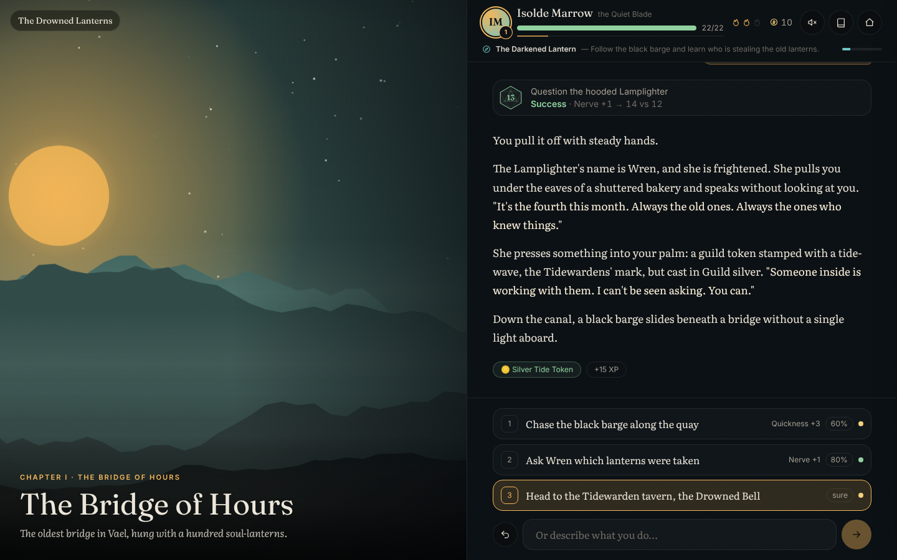
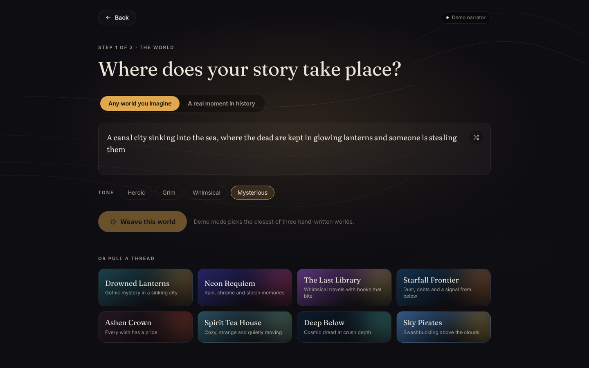
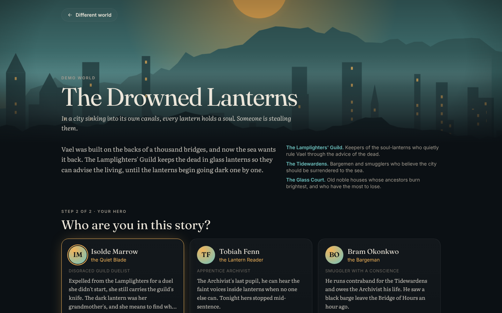
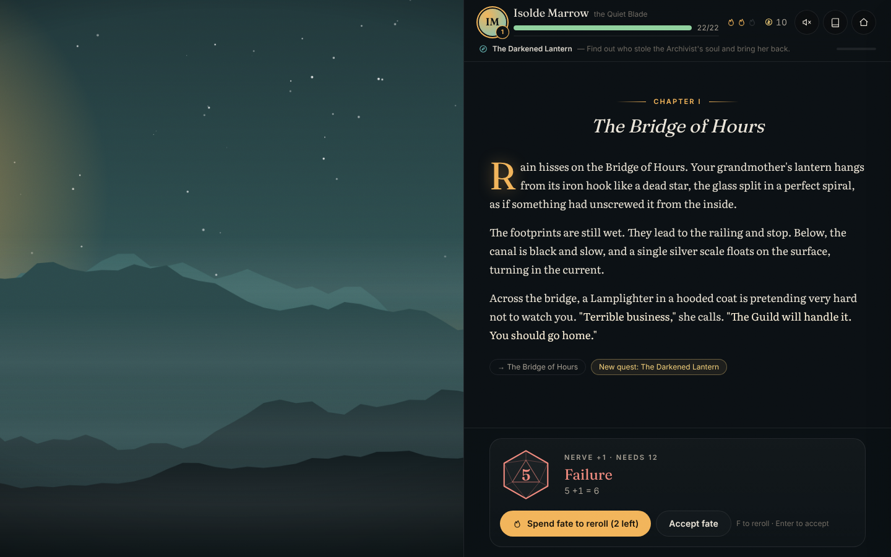
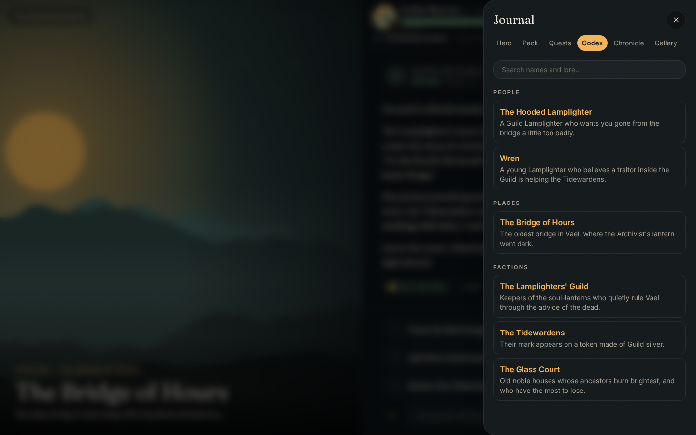
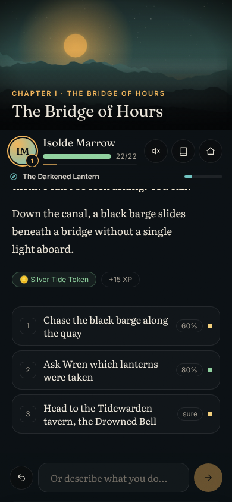

# Realmweaver

An illustrated, AI-narrated role-playing game. Name any world, real or imagined, pick who you are, and write the story together with a narrator who remembers everything and rolls the dice fairly.



## What makes it work

- **A narrator with rules.** Claude or Gemini writes the story, but a small rules engine owns the numbers. Risky actions roll a d20 plus one of four stats against a difficulty, with five outcomes from critical success through *success at a cost* to critical failure. The narrator can only change health, gold, items and quests within the engine's limits, so typing "I find a legendary sword" doesn't work.
- **Choices with honest odds.** Every turn offers three ways forward with the stat they use, your chance of success and how risky they are. You can always type your own action instead.
- **Fate.** Spend a fate point to reroll a failure. Levelling up restores fate and lets you raise a stat.
- **Memory.** Every turn adds a line to the Chronicle, and the narrator keeps a Codex of the people, places and factions you meet. Both are sent back each turn, so the story stays consistent over long campaigns.
- **Worlds with their own look.** World creation picks an art direction and a palette, and the whole interface re-tints to match. Each location gets a generated painted vista, and with a Gemini key every new scene is illustrated.
- **History mode.** Pick a real moment (Florence 1492, Whitechapel 1888, Apollo 11) and the narrator keeps every detail accurate, with short "From the archives" notes about what really happened.
- **Streaming.** The narration appears word by word while the dice tumble.
- **Rewind and saves.** Every turn autosaves to the browser. Rewind the last turns, keep multiple tales, and export or import them as files. No account needed.
- **Plays without keys.** With no API key, a hand-written demo narrator plays the first five scenes of three different worlds, so you can try everything.

| World | Hero | Fate | Journal | Phone |
| --- | --- | --- | --- | --- |
|  |  |  |  |  |

## Running it

```bash
npm install
cp .env.example .env.local   # optional: add keys
npm run dev                  # http://localhost:3000
```

| Variable | Purpose |
| --- | --- |
| `ANTHROPIC_API_KEY` | Claude narrates turns and builds worlds. |
| `GEMINI_API_KEY` | Paints scene illustrations and the hero portrait. Gemini also narrates when there is no Claude key. |
| `REALMWEAVER_NARRATOR` | Optional: `claude`, `gemini` or `demo` to pick the narrator when both keys are set. With neither key, the demo narrator runs. |
| `REALMWEAVER_MODEL` | Claude model, default `claude-opus-5-5`. |
| `GEMINI_MODEL` | Gemini narrator model, default `gemini-3.8-flash`. |
| `REALMWEAVER_EFFORT` | Thinking effort per turn, default `low` for snappy turns. World creation uses `medium`. |
| `GEMINI_IMAGE_MODEL` | Image model, default `gemini-3.1-flash-image`. |

Other scripts: `npm test` (rules engine and parsers), `npm run typecheck`, `npm run lint`, `npm run build`.

## How a turn works

1. The player picks a choice or types an action. A chosen action with a stat is rolled immediately in the browser, so the dice animate while the narrator writes. A failed roll can be rerolled with fate.
2. `POST /api/turn` streams Server-Sent Events. For typed actions, the narrator may call the `roll_check` tool; the server rolls and returns the result, and Claude must honor it.
3. The narrator answers with structured output: narration plus effects, quest and codex updates, a scene description, mood and the next three choices. Narration is streamed out of the partial JSON as it is generated.
4. The client applies the result through the rules engine (`applyResolution`), which clamps and validates everything, awards quest XP, handles level ups and death, then saves.
5. If the scene changed, the illustration is painted in the background and cross-fades in.

```
src/
├── app/api/        turn (SSE), world, image, status
├── components/     Title, Loom (world), Weaving, Hero, play/ (PlayScreen, Hud, StoryLog, Composer, Dice, Journal)
└── lib/
    ├── engine/     dice and rules: the source of truth for every number
    ├── gm/         Claude and Gemini narrators, prompts, schemas, demo narrator, Gemini painter
    └── client/     IndexedDB saves, streaming client, theming
```

`src/lib/gm/narrator.ts` picks the narrator. The Claude call (`claude.ts`) uses adaptive thinking, structured outputs, one cached system prompt (rules plus world bible) and server-side refusal fallback. The Gemini call (`gemini.ts`) sends the same prompts, JSON schema and `roll_check` function with low thinking.
